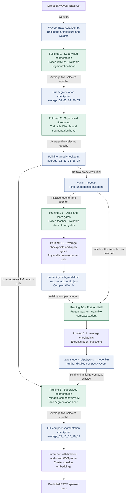
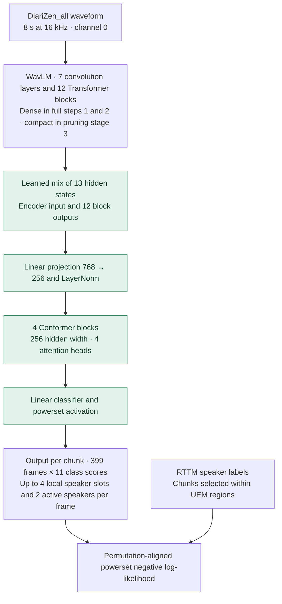
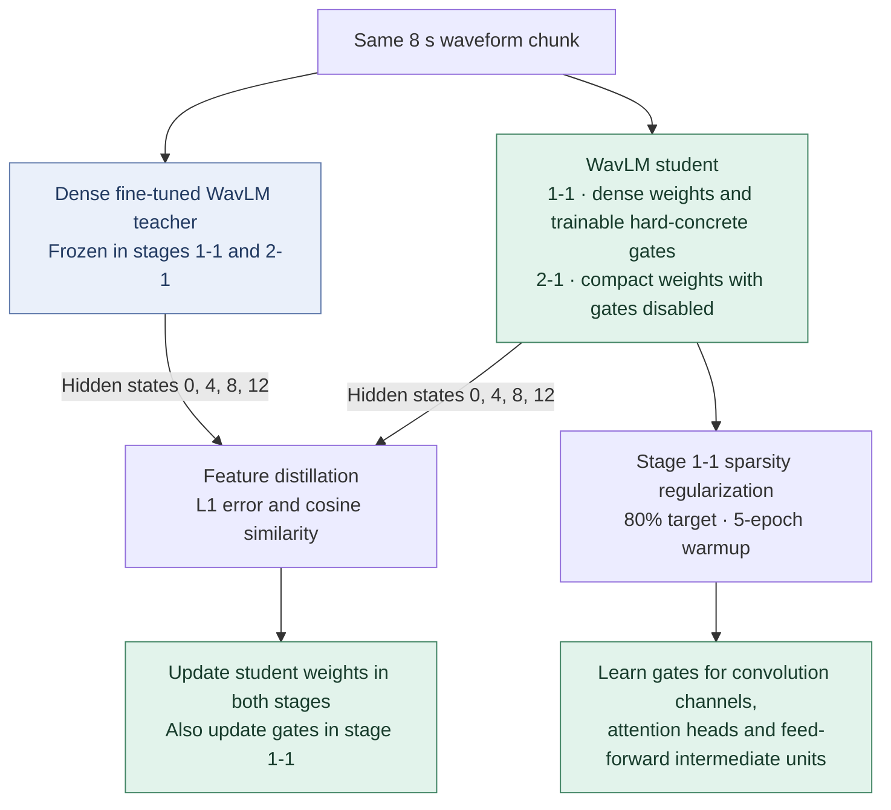

# Training, pruning, and evaluation restart guide

This branch records the local adaptations on top of upstream commit
`844f5555b0a98acd0931511fc641a8c5b8ba92c7`. Its entry points run training
phases independently, provide checkpoint conversion/averaging utilities, and
make evaluation device selection explicit. The original upstream recipes remain
available.

The examples below use Bash on Linux. Set `REPO` to your clone. The historical
installation is `/dataC/jianyou/DiariZen`; several supplied TOMLs deliberately
retain paths from that installation. Review the path checklist before launching
a fresh experiment. A Git clone does not recover datasets or trained weights.

## 1. Workflow and checkpoint contracts

There are two naming systems: the initial full segmentation training has two
steps, followed by pruning stages 1, 2, and 3. Stage 1 includes **both** pruning
training (1-1) and materializing the compact model (1-2). Stage 2 includes
further distillation (2-1) and student extraction (2-2).

| Phase | Entry point (relative to repository) | Configuration | Default experiment, relative to its recipe |
| --- | --- | --- | --- |
| Train segmentation with frozen WavLM | `recipes/diar_ssl/run_train_only_single.sh` | `conf/wavlm_frozen_conformer_all.toml` | `exp/wavlm_frozen_conformer_all` |
| Fine-tune WavLM and segmentation head | `recipes/diar_ssl/run_train_only_dual.sh` | `conf/wavlm_updated_conformer_all.toml` | `exp/wavlm_updated_conformer_all` |
| Pruning stage 1-1 and 1-2 | `recipes/diar_ssl_pruning/run_stage1_only.sh` | `conf/s80_base_all.toml` | `exp/s80_base_all` |
| Pruning stage 2-1 and 2-2 | `recipes/diar_ssl_pruning/run_stage2_only.sh` | copied `s80_base_all.toml` | `exp/s80_base_all_further_distill` |
| Pruning stage 3: segmentation training | `recipes/diar_ssl_pruning/run_stage3_only.sh` | copied `conf/dual_opt_common_all.toml` | `exp/s80_base_all_further_distill_diar_training` |

Stage 2 and stage 3 use temporary config copies with the experiment-specific
basename, because the Python runner derives `meta.exp_id` from that basename.
The source configs are preserved. Trainers write the effective CLI-overridden
configuration to `exp/<experiment>/config__*.toml`.

| Artifact | Contents | Appropriate consumer |
| --- | --- | --- |
| Microsoft's original `WavLM-Base+.pt` | `{cfg, model}` in Microsoft key layout | `convert_microsoft_wavlm.py` |
| Converted `WavLM-Base+.diarizen.pt` | `{config, state_dict}`, backbone only | Segmentation model bootstrap; extraction reference |
| Segmentation `epoch_NNNN/pytorch_model.bin` or a manually averaged segmentation file | Raw model state dict: `wavlm_model.*`, `weight_sum.*`, `proj.*`, `lnorm.*`, `conformer.*`, `classifier.*` | Full segmentation fine-tuning and inference; backbone extraction |
| Exported `wavlm_model.pt` | `{config, state_dict}`, fine-tuned backbone only | Stage-1 teacher and student |
| Stage-1 `pruned/pytorch_model.bin` | `{config, state_dict}`, physically compact WavLM | Stage 2 |
| Stage-2 `avg_student_ckpt/pytorch_model.bin` | `{config, state_dict}`, further-distilled compact WavLM | Stage-3 WavLM constructor |
| Stage-3 epoch or averaged checkpoint | Full segmentation state dict using compact WavLM | Evaluation |

An averaged model file contains weights, not optimizer, scheduler, RNG, or
trainer progress. Use a complete epoch checkpoint directory for `RESUME=1`.
The backbone-only artifacts contain no Conformer/classifier. Pruning stages
1 and 2 still use diarization **audio**: the student learns teacher feature
representations on that audio, without the segmentation head. Stage 3 restores
supervised segmentation training with RTTM labels.

### Training stages and checkpoint handoffs

The workflow trains a full WavLM–Conformer diarizer, then compresses its WavLM
backbone through two rounds of distillation. Pruning stage 3 combines the compact
WavLM from stage 2 with the segmentation head from the full fine-tuned model and
trains both on labeled audio. The average directory names in the diagram
identify the historical runs.



Stages **1-2** and **2-2** process checkpoints without gradient updates. They
select the lowest development-loss checkpoints from the peak development-loss
epoch onward, including that epoch, with a configurable cap of five by default.
Stage 1-2 applies the learned gates to shrink the architecture. Stage 2-2
exports the further-distilled student in the same compact architecture.

### Supervised segmentation model

Full steps 1 and 2 and pruning stage 3 share this forward path. The segmentation
head includes every learned module from the layer mix through the classifier.



The head trains in all three supervised steps. WavLM is frozen in full step 1,
then updated alongside the head in full step 2 and pruning stage 3.

### WavLM distillation model



The teacher's hidden states provide supervision in both distillation stages. The
dataset loader reads RTTM and UEM metadata, while the distillation loss uses the
waveform-derived features.

In the historical run, compaction reduced WavLM from **94.38M to 18.88M
parameters** and from **144 to 21 attention heads**. The compact backbone
retains **12 Transformer blocks and a 768-wide output**, so stage 3 can reuse
the full model's layer mix, projection, normalization, Conformer and classifier.


## 2. Rebuild the environment

```bash
git clone --branch split_train_stages --recurse-submodules \
  https://github.com/frankyoujian/DiariZen.git
cd DiariZen
export REPO="$PWD"
python3.10 -m venv .venv
.venv/bin/python -m pip install --upgrade pip
.venv/bin/python -m pip install \
  torch==2.1.1 torchvision==0.16.1 torchaudio==2.1.1 \
  --index-url https://download.pytorch.org/whl/cu121
.venv/bin/python -m pip install -r requirements.txt -c constraints.txt
.venv/bin/python -m pip install -e . -c constraints.txt
.venv/bin/python -m pip install -e './pyannote-audio[dev,testing]' -c constraints.txt
git submodule update --init --recursive
.venv/bin/python -m pip install -r dscore/requirements.txt
export PYTHONPATH="$REPO${PYTHONPATH:+:$PYTHONPATH}"
.venv/bin/python -m pip check
```

The standalone launchers explicitly use `<repo>/.venv/bin/python` and
`<repo>/.venv/bin/accelerate`; activating a differently named conda environment
alone will not satisfy them. The observed core environment was Python 3.10.12,
PyTorch 2.1.1+cu121, torchvision 0.16.1+cu121, torchaudio 2.1.1+cu121,
NumPy 1.26.4, Accelerate 1.6.0. This is a reference, not a complete dependency
lock. `constraints.txt` constrains the Torch stack and NumPy, while other
requirements remain open. Resolve `pip check` failures before a long run and
save a known-working `pip freeze` alongside your external experiment archive.

The server environment has reported a Transformers/PyTorch-version warning
(Transformers expecting Torch >=2.5). That warning is separate from the local
WavLM implementation; this branch does not claim a fully locked clean-install
test or recommend upgrading the pinned Torch stack without verification.

Check the GPU environment before reserving a training slot:

```bash
nvidia-smi
.venv/bin/python -c 'import torch, accelerate; print(torch.__version__, accelerate.__version__); print(torch.cuda.is_available(), torch.cuda.device_count())'
```

## 3. Prepare the consolidated datasets

Obtain the underlying corpora and their metadata separately. This branch ships
the preparation code, not corpus audio, annotations, or generated manifests.
The builder reads pyannote database protocols plus preprocessed RAMC and
NOTSOFAR manifests:

```bash
cd "$REPO"
.venv/bin/python recipes/diar_ssl/prepare_diarizen_all.py \
  --database /path/to/database_DiariZen.yml \
  --ramc /path/to/MagicData-RAMC/processed \
  --notsofar /path/to/NOTSOFAR/processed \
  --output recipes/diar_ssl/data/DiariZen_all \
  --verify-audio
```

It builds `train`, `dev`, and `test` directories containing `wav.scp`, `rttm`,
and `all.uem`, plus per-dataset splits under `by_dataset`, a README, and
`manifest.json`. Recording IDs are namespaced as `dataset__uri` to avoid
cross-corpus collisions. Available test protocols are included; not every
dataset necessarily contributes every split. The builder refuses an existing
output directory. Audio paths must identify existing files; shell-pipeline
`wav.scp` entries and paths containing whitespace are unsupported. Use
`--verify-audio` to check audio properties rather than assuming a valid suffix
means 16 kHz audio.

The supplied training configs expect the same manifests in the pruning recipe.
On a new clone, share them with a symlink (only when the destination is absent):

```bash
cd "$REPO"
ln -s ../../diar_ssl/data/DiariZen_all recipes/diar_ssl_pruning/data/DiariZen_all
```

All train/dev SCP, RTTM, and UEM recording IDs must agree. The loader now
raises for a genuine mismatch, omits recordings too short for a full chunk,
and handles interleaved RTTM sessions without mixing their speaker labels.
The selected waveform channel defaults to mono extraction. The segmentation
model configs select channel 0.

## 4. Obtain and convert the bootstrap WavLM

Place the original Microsoft Base+ checkpoint at `pretrained/WavLM-Base+.pt`.
Place the WeSpeaker embedding checkpoint at
`pretrained/pyannote3/wespeaker-voxceleb-resnet34-LM/pytorch_model.bin` for
later evaluation. Model downloads and their access terms are external to this
branch; follow the repository's existing model-license information.

```bash
cd "$REPO"
.venv/bin/python recipes/diar_ssl/convert_microsoft_wavlm.py \
  pretrained/WavLM-Base+.pt pretrained/WavLM-Base+.diarizen.pt
```

This converter is specifically for the original Base+/base architecture. It
maps the Microsoft keys, verifies coverage and shapes, and writes the schema
used by the current DiariZen implementation. It refuses an existing output.

Before training, edit `model.args.wavlm_src` in both
`recipes/diar_ssl/conf/wavlm_{frozen,updated}_conformer_all.toml` to the actual
converted checkpoint. The checked-in paths are historical absolute paths.
Keep each experiment's effective config snapshot with its checkpoints.

## 5. Train the full segmentation model in two independent steps

Frozen-backbone training uses 100 maximum epochs, batch 64 per GPU (dev 8),
and LR `1e-3`. The next step uses 100 maximum epochs, batch 32 per GPU (dev 8),
WavLM LR `2e-5`, and non-WavLM LR `1e-3`. These are supplied config values,
not memory guarantees for every GPU.

```bash
cd "$REPO/recipes/diar_ssl"
bash run_train_only_single.sh
```

Choose five epochs from development results, then average their full model
states. This example uses epoch IDs as placeholders; replace them with the
five epochs you actually want:

```bash
cd "$REPO"
.venv/bin/python recipes/diar_ssl/average_selected_checkpoints.py \
  --checkpoint-root recipes/diar_ssl/exp/wavlm_frozen_conformer_all/checkpoints \
  --epochs 64 65 69 70 72 \
  --output recipes/diar_ssl/exp/wavlm_frozen_conformer_all/checkpoints/average_64_65_69_70_72
```

Exactly five distinct epochs are required. Keys, shapes, and dtypes must
agree. Floating tensors are averaged (FP16/BF16 accumulate in FP32); integer
buffers retain the first checkpoint's values, with a warning when they differ.
Outputs are saved atomically and require `--force` to replace an existing file.

Run the dual-optimizer step using that averaged model:

```bash
cd "$REPO/recipes/diar_ssl"
FINETUNE_CKPT="$REPO/recipes/diar_ssl/exp/wavlm_frozen_conformer_all/checkpoints/average_64_65_69_70_72/pytorch_model.bin" \
  bash run_train_only_dual.sh
```

The launcher default `FINETUNE_CKPT` instead points to a historical
`exp_ReduceLROnPlataeu/.../average_64_65_69_70_72` run. Override it when starting
from newly trained artifacts. `run_dual_opt.py` now validates and applies
`-FT --ckpt_path` instead of silently ignoring those CLI inputs.

Average five selected fine-tuned epochs and extract their backbone:

```bash
cd "$REPO"
export FT_CHECKPOINTS="$REPO/recipes/diar_ssl/exp/wavlm_updated_conformer_all/checkpoints"
export FT_AVERAGE="$FT_CHECKPOINTS/average_32_33_35_36_37"
.venv/bin/python recipes/diar_ssl/average_selected_checkpoints.py \
  --checkpoint-root "$FT_CHECKPOINTS" --epochs 32 33 35 36 37 \
  --output "$FT_AVERAGE"
.venv/bin/python recipes/diar_ssl_pruning/extract_wavlm_from_averaged_checkpoint.py \
  --input "$FT_AVERAGE/pytorch_model.bin" \
  --output "$FT_AVERAGE/wavlm_model.pt" \
  --bootstrap pretrained/WavLM-Base+.diarizen.pt
```

The extractor selects `wavlm_model.*`, removes that prefix, checks exact
keys/shapes/dtypes against the bootstrap, and performs a strict model load.
It preserves the fine-tuned backbone weights; it does not replace them with
the bootstrap weights or average the checkpoint a second time. Retain both
outputs: stage 1 needs `wavlm_model.pt`, while stage 3 needs the full
`pytorch_model.bin` to initialize the segmentation head.

## 6. Pruning stage 1: distill, learn gates, materialize compact WavLM

Edit both `teacher_ckpt` and `student_ckpt` in
`recipes/diar_ssl_pruning/conf/s80_base_all.toml` to your extracted
`$FT_AVERAGE/wavlm_model.pt`. The checked-in values point to the historical
`exp_step_1_2_finetune_wavlm/.../average_32_33_35_36_37` directory.

The default config requests 80% target sparsity, 5 sparsity-warmup epochs,
30 maximum epochs, batch 16 per GPU, distillation LR `2e-4`, and gate LR
`2e-2`. Supported pruning units here are convolution channels, attention
heads, and feed-forward intermediate units.

```bash
cd "$REPO/recipes/diar_ssl_pruning"
bash run_stage1_only.sh
```

After training, the launcher consolidates validation metrics across logs,
checks that referenced checkpoints exist, and runs `apply_pruning.py --mode
prune`. Checkpoint selection follows the existing utility: find the maximum
validation-loss point, then select up to `AVG_CKPT_NUM` lowest-loss checkpoints
from that point onward. It does not always mean globally best five epochs.
Both of these artifacts must exist before stage 2:

```text
exp/s80_base_all/pruned/pytorch_model.bin
exp/s80_base_all/pruned/pruned_config.json
```

## 7. Pruning stage 2: further distill and extract

```bash
cd "$REPO/recipes/diar_ssl_pruning"
bash run_stage2_only.sh
# Optional overrides for a fresh run:
# BATCH_SIZE=16 MAX_EPOCHS=20 AVG_CKPT_NUM=5 bash run_stage2_only.sh
```

Stage 2 initializes its student from stage 1's compact checkpoint, retains the
same teacher/audio, disables pruning regularization and gate creation, and
uses 20 maximum epochs by default. The CLI overrides the copied config at
runtime. Stage 2-2 uses the generated runtime config beside its checkpoints,
aggregates metrics across logs, averages selected checkpoints with the same
post-peak rule, and extracts only the student backbone:

```text
exp/s80_base_all_further_distill/avg_student_ckpt/pytorch_model.bin
```

Wait for the entire stage-2 launcher to exit successfully, including extraction.
`apply_pruning.py` writes directly to its final output; a filename appearing
does not by itself establish completion.

## 8. Pruning stage 3: train the compact segmentation model

```bash
cd "$REPO/recipes/diar_ssl_pruning"
FINETUNE_CKPT="$FT_AVERAGE/pytorch_model.bin" bash run_stage3_only.sh
```

Stage 3 uses `conf/dual_opt_common_all.toml`. It constructs the WavLM module
from stage 2, then strictly loads **only** the non-`wavlm_model.*` tensors from
the full fine-tuned segmentation checkpoint. This includes layer weighting,
projection, normalization, Conformer parameters and buffers, and classifier.
Missing, unexpected, or shape-incompatible non-WavLM tensors fail loudly.
The historical Base+ segmentation checkpoint has 248 WavLM tensors and 155
non-WavLM tensors; all 155 are compatible with the supplied head config.

The CLI override of `wavlm_src` is essential: the source TOML currently retains
a full segmentation checkpoint path, which is not a backbone constructor
input. The launcher supplies the proper stage-2 checkpoint and leaves the
source TOML untouched. For an alternative stage-2 location:

```bash
PRUNED_CKPT=/path/to/avg_student_ckpt/pytorch_model.bin \
FINETUNE_CKPT=/path/to/full/averaged/pytorch_model.bin \
  bash run_stage3_only.sh
```

Both optimizers are created after selective initialization. On `RESUME=1`,
selective head initialization is skipped; Accelerate restores the complete
stage-3 model, optimizers, schedulers, and saved trainer state. The constructor
still needs the stage-2 checkpoint to reconstruct the compact architecture.
Default stage 3 is 20 maximum epochs, batch 16 per GPU, WavLM LR `2e-5`, other
modules LR `1e-3`, with development validation enabled.

## 9. GPU controls, dry runs, resume, and artifacts

All launchers default to eight GPUs, port 1134, and four OMP/MKL threads.
Per-GPU batch size comes from the config, except stage 2's `BATCH_SIZE` override.
For a different GPU count, set both variables:

```bash
CUDA_VISIBLE_DEVICES=0,1 NUM_PROCESSES=2 MAIN_PROCESS_PORT=1135 \
  bash run_stage2_only.sh
RESUME=1 bash run_stage2_only.sh
DRY_RUN=1 bash run_stage3_only.sh
```

`MAX_EPOCHS` is a total limit, not an additional number of epochs on resume.
`AVG_CKPT_NUM` is supported by stages 1 and 2. Stage 3 supports `PRUNED_CKPT`
and `FINETUNE_CKPT`; the initial dual step supports `FINETUNE_CKPT`.

Single/dual/stage-1 dry runs perform input and CUDA preflight. Stage 1 also
checks whether the experiment exists; use `RESUME=1 DRY_RUN=1` when inspecting
an existing experiment. Stage-2/stage-3 dry runs exit before artifact/CUDA
checks and print commands without creating directories or configs.

Stages 1/2/3 guard fresh output directories; a fresh run refuses an existing
experiment and asks for `RESUME=1`. Stages 2/3 have process/prerequisite guards
for their preceding stages and duplicate jobs. The original initial
single/dual launchers have fewer output-directory guards: inspect output and
set resume deliberately before launching them. A different rendezvous port
does not free occupied GPU memory. Run phases sequentially unless intentionally
allocating separate resources. These scripts do not schedule future work.

Keep these external experiment files together:

```text
exp/<experiment>/
  config__<timestamp>.toml
  <experiment>_<timestamp>.log
  tb_log/
  checkpoints/epoch_NNNN/
    pytorch_model.bin
    optimizer*.bin
    custom_checkpoint_*.pkl
    random_states_*.pkl
  val_metric_summary.lst        # stages 1/2; build separately for segmentation
```

Plateau schedulers use configured factor/minimum LR, register their state with
Accelerate, and step once per rank from a synchronized validation score. The
pruning trainer supports legacy checkpoints without scheduler state by loading
trainer state first and registering a fresh scheduler afterward. That adapter
does not exist for old single/dual checkpoints, which may fail custom-state
count validation. Preserve those old checkpoints and restart as a new weights-
initialized experiment if full resume is incompatible.

Pruning plateau updates start only after `sparsity_warmup_epochs`. Current
stage-2 CLI removes that key, causing the trainer default of five epochs to
apply there too: plateau updates begin at epoch 6 even without regularization.
This guide records current behavior. Dual-optimizer checkpoints are saved
after validation; the pruning trainer also has a pre-validation epoch save,
so the most recent validation state need not be in every pruning epoch file.
Exact cross-rank RNG reproducibility depends on which RNG files were saved.

## 10. Evaluate a full segmentation checkpoint

Use a saved `config__*.toml` from the experiment, especially for stage 3. It
records the compact WavLM architecture source and all runtime overrides. Avoid
using the unmodified source TOML for evaluation. The inference code also derives
checkpoint paths from the config's parent directory.

Average five full stage-3 epoch files with `average_selected_checkpoints.py`
(choose actual epoch IDs), then run inference from the pruning recipe:

```bash
cd "$REPO/recipes/diar_ssl_pruning"
export CONFIG=/absolute/path/to/exp/s80_base_all_further_distill_diar_training/config__TIMESTAMP.toml
export SEGMENTATION=/absolute/path/to/averaged/full/segmentation/pytorch_model.bin
export EMBEDDING="$REPO/pretrained/pyannote3/wespeaker-voxceleb-resnet34-LM/pytorch_model.bin"
CUDA_VISIBLE_DEVICES=2 ../../.venv/bin/python infer_avg.py \
  -C "$CONFIG" \
  -i data/DiariZen_all/by_dataset/AMI-SDM/test/wav.scp \
  -o output/stage3/AMI-SDM \
  --segmentation_model "$SEGMENTATION" \
  --embedding_model "$EMBEDDING" \
  --gpu_id 0 --seg_duration 8 \
  --clustering_method AgglomerativeClustering \
  --ahc_threshold 0.70 --min_cluster_size 30
```

Use `recipes/diar_ssl/infer_avg.py` from its own recipe directory for the
unpruned experiments. `--gpu_id` indexes **visible** devices: physical GPU 2
becomes index 0 when `CUDA_VISIBLE_DEVICES=2`. Invalid indices fail early.
When `--gpu_id` is omitted, CPU is selected if CUDA is unavailable; an explicitly
requested GPU fails when CUDA is unavailable. Explicit AHC avoids the default VBx
mode's additional PLDA assets under `--diarizen_hub`.

Alternatively omit `--segmentation_model` and provide
`--val_metric_summary`, `--avg_ckpt_num 5`, `--val_metric Loss` (or `DER`),
and `--val_mode best` (or `prev`/`center`) to use the existing selection code.
That summary must contain segmentation `Validation Loss/DER on epoch ...`
messages, not stage-1/stage-2 distillation messages. For example, build a
deduplicated summary from segmentation logs:

```bash
../../.venv/bin/python - "$CONFIG" <<'PY'
from pathlib import Path
import re
import sys
experiment = Path(sys.argv[1]).resolve().parent
metrics = {}
for log in sorted(experiment.glob('*.log')):
    for line in log.read_text(errors='replace').splitlines():
        match = re.search(r'(Validation Loss/DER on epoch (\d+):.*)', line)
        if match:
            epoch, message = int(match[2]), match[1].strip()
            if epoch in metrics and metrics[epoch] != message:
                raise RuntimeError(f'Conflicting validation metrics for epoch {epoch}')
            metrics[epoch] = message
if not metrics:
    raise RuntimeError('No segmentation validation metrics found')
(experiment / 'val_metric_summary.lst').write_text(
    '\n'.join(metrics[e] for e in sorted(metrics)) + '\n')
PY
```

Score the matching RTTMs with collar 0:

```bash
cd "$REPO"
.venv/bin/python dscore/score.py \
  -r recipes/diar_ssl_pruning/data/DiariZen_all/by_dataset/AMI-SDM/test/rttm \
  -s recipes/diar_ssl_pruning/output/stage3/AMI-SDM/*.rttm \
  --collar 0
```

When evaluating another corpus, change both SCP and reference RTTM together.
Archive the effective config, chosen epochs, metric summary, clustering
settings, UEM/collar policy, dataset version, and score output. Numbers from
different dataset splits or scoring policies are not directly comparable.

## 11. Optional ONNX segmentation export

See [runtime/README.md](../runtime/README.md) for exporter and validator usage.
These tools target the released `BUT-FIT/diarizen-wavlm-large-s80-md` model,
not the locally trained Base+ stage-3 checkpoint. They export only neural
segmentation; embeddings, clustering, sliding-window assembly, and RTTM output
remain outside the graph.

```bash
cd "$REPO"
.venv/bin/python -m pip install -r runtime/requirements-onnx.txt
.venv/bin/python runtime/export_segmentation_onnx.py
.venv/bin/python runtime/validate_segmentation_onnx.py \
  --provider cpu --report runtime/segmentation.validation-cpu.json
# Run on a reserved GPU only:
# .venv/bin/python runtime/validate_segmentation_onnx.py \
#   --provider cuda --cuda-device 0 --report runtime/segmentation.validation-cuda.json
```

The default model uses 16-second waveform chunks `[batch, 1, 256000]`, outputs
`[batch, 799, 11]`, and has a dynamic batch axis. The validator tests batches
1 and 3; keep dynamic batching enabled. The convenience wrapper forwards custom
arguments only to the exporter, so use separate commands with matching model,
cache, and ONNX paths when customizing. HF downloads use the default revision;
record the resolved revision and artifact checksum for reproducibility.
`runtime/VALIDATION.md` contains historical results, not a new validation run
performed while preparing this branch. The generated ONNX graph, cache,
metadata, and JSON validation reports are deliberately excluded from Git.

## 12. Troubleshooting and code map

| Symptom | Check/action |
| --- | --- |
| Missing `.venv/bin/accelerate` | Create the repository-root venv and install requirements there. |
| Input/config path does not exist | Replace historical `/dataC/jianyou/DiariZen` paths and verify the dataset links. |
| Stage 1 teacher rejects checkpoint schema | Supply extracted `wavlm_model.pt`, not the full segmentation `pytorch_model.bin`. |
| Student log mentions pruning-gate tensors | New hard-concrete gates initialize from defaults; the loader requires complete compatible backbone coverage. |
| LibriConvo recording mismatch | Compare exact SCP/RTTM/UEM IDs; too-short recordings are skipped separately and no longer produce false unmatched messages. |
| Stage 2/3 refuses to start | Wait for the complete preceding launcher to exit and verify its output artifacts; inspect duplicate jobs and fresh/resume mode. |
| Stage 3 shape/key failure | Use the full matching segmentation checkpoint for `FINETUNE_CKPT` and stage-2 backbone for `PRUNED_CKPT`; architecture must match the head config. |
| Scheduler attribute failure after validation | Confirm these trainer changes are installed; do not monkey-patch only the `.step()` call. |
| Accelerate custom-state count failure on old resume | Legacy adapter is pruning-only; use compatible checkpoint versions or a separate weights-initialized run. |
| GPU index out of range | Count CUDA-visible devices, then choose `--gpu_id` within that list. |
| Inference cannot find epoch checkpoints | Use a saved runtime config located beside the experiment's `checkpoints/`. |
| No five useful pruning checkpoints | Inspect post-peak metrics; `AVG_CKPT_NUM` is an upper bound in pruning selection, while manual averaging requires exactly five. |

Implementation map:

- `diarizen/trainer_{single_opt,dual_opt,distill_prune}.py`: scheduler creation,
  distributed score synchronization, checkpoint state, sparsity warmup.
- `diarizen/models/pruning/model_distill_prune.py`: teacher/student schema and
  key validation; supported pruning units and new gate initialization.
- `recipes/{diar_ssl,diar_ssl_pruning}/dataset.py`: indexed session lookup,
  short-recording handling, mono extraction, speaker-label preservation.
- `recipes/diar_ssl/run_dual_opt.py`: validated full-model fine-tune CLI.
- `recipes/diar_ssl_pruning/run_dual_opt_continued_training.py`: stage-3
  hybrid initialization and strict non-WavLM loading.
- `prepare_diarizen_all.py`, `convert_microsoft_wavlm.py`,
  `average_selected_checkpoints.py`, and
  `extract_wavlm_from_averaged_checkpoint.py`: reproducible preparation steps.
- Both `infer_avg.py`: explicit validated inference GPU selection.
- `runtime/`: released-model segmentation export and parity checking.

Tracked dataset SCP templates retain their upstream contents. The server's
local path rewrites remain local; regenerate/remap data for each machine.
The branch excludes pretrained/averaged weights, experimental output, generated
manifests, runtime cache, and local patch/backup files. Keep those in a separate
artifact store with checksums and a machine/environment inventory.
